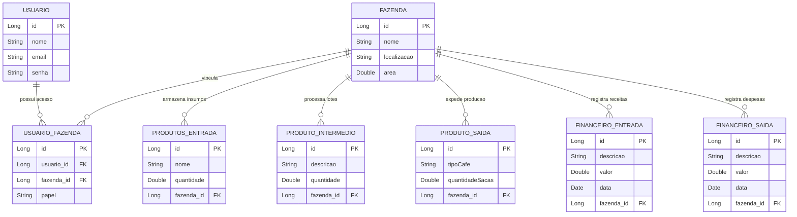

# ☕ SIGA — Sistema Integrado de Gestão Agrícola (Cafeicultura)


O **SIGA (`gestao-cafe`)** é uma aplicação **Full-Stack** desenvolvida para o gerenciamento integrado de propriedades cafeeiras. O sistema conecta uma interface web responsiva a uma **API REST em Java com Spring Boot**, utilizando **Spring Data JPA / Hibernate** e banco de dados relacional **MySQL** para controle multiusuário de fazendas, rastreamento de estoque agrícola (insumos, café em processamento e produto final) e gestão financeira.

---

## ✨ Funcionalidades Principais

- **🔐 Autenticação e Controle de Acesso Multiusuário (`AutenticacaoController`, `UsuarioFazendaController`):**
  - Cadastro e login de usuários com vínculo de permissões por propriedade rural (`UsuarioFazenda`).
- **🌱 Gestão de Propriedades Cafeeiras (`FazendaController`):**
  - Cadastro, listagem e visualização detalhada de fazendas vinculadas a cada produtor/usuário.
- **📦 Controle de Estoque em 3 Estágios (`ProdutosEntrada`, `ProdutoIntermedio`, `ProdutoSaida`):**
  - **Entrada:** Controle de insumos agrícolas, defensivos, fertilizantes e materiais adquiridos.
  - **Intermediário:** Acompanhamento de lotes de café colhidos e em fase de beneficiamento/secagem.
  - **Saída:** Registro de café beneficiado pronto para comercialização e expedição.
- **💰 Gestão Financeira (`FinanceiroEntradaController`, `FinanceiroSaidaController`):**
  - Lançamento e categorização de receitas (vendas de lotes/sacas) e despesas operacionais da fazenda.
- **📊 Dashboard Gerencial (`DashboardController`):**
  - Consolidação de indicadores financeiros e de estoque por fazenda para apoio à tomada de decisão.

---

## 🏗️ Arquitetura e Modelagem de Dados

O Back-End segue a arquitetura em camadas do ecossistema **Spring Boot** (`Controller` REST → `Repository` Spring Data JPA → `Model` JPA/Hibernate → `MySQL`), com configuração de CORS (`CorsConfig`) para comunicação com o Front-End.



---

## 📂 Estrutura do Repositório

```text
SIGA/
├── java/gestao-cafe/
│   ├── src/main/java/br/com/nextdev/gestao_cafe/
│   │   ├── config/
│   │   │   └── CorsConfig.java                  # Configuração de CORS da API REST
│   │   ├── controller/                          # Endpoints REST (@RestController)
│   │   │   ├── AutenticacaoController.java
│   │   │   ├── DashboardController.java
│   │   │   ├── FazendaController.java
│   │   │   ├── FinanceiroEntradaController.java
│   │   │   ├── FinanceiroSaidaController.java
│   │   │   ├── ProdutosEntradaController.java
│   │   │   ├── ProdutoIntermedioController.java
│   │   │   ├── ProdutoSaidaController.java
│   │   │   ├── UsuarioController.java
│   │   │   └── UsuarioFazendaController.java
│   │   ├── model/                               # Entidades JPA (@Entity)
│   │   ├── repository/                          # Interfaces Spring Data JPA (JpaRepository)
│   │   └── GestaoCafeApplication.java           # Classe principal Spring Boot
│   ├── src/main/resources/
│   │   ├── application.properties               # Configurações de conexão MySQL e Hibernate
│   │   └── static/                              # Recursos estáticos integrados ao servidor
│   └── pom.xml                                  # Dependências Maven (Spring Web, Data JPA, MySQL)
├── html/                                        # Páginas Front-End (Login, Home, Fazendas, Estoque, Financeiro)
├── css/                                         # Estilização customizada + Bootstrap
├── javascript/                                  # Consumo da API REST via Fetch API e controle de sessão
└── mysql/
    └── cafe_db.sql                              # Script SQL de estruturação inicial do banco
```

---

## 🚀 Como Executar Localmente

### Pré-requisitos
- **Java JDK 17+**
- **MySQL Server 8+**
- **Maven** (ou utilizar o wrapper `./mvnw` incluso no projeto)

### 1. Clonar o repositório e configurar o Banco de Dados

```bash
git clone https://github.com/DaviMirandaVaz/SIGA.git
cd SIGA
```

No seu servidor MySQL, crie o banco de dados (ou importe o arquivo `mysql/cafe_db.sql`):

```sql
CREATE DATABASE cafe_db;
```

Verifique as credenciais de acesso ao MySQL no arquivo `java/gestao-cafe/src/main/resources/application.properties`.

### 2. Iniciar a aplicação Spring Boot

```bash
cd java/gestao-cafe
./mvnw spring-boot:run
```
*(No Windows PowerShell/CMD, utilize `mvnw.cmd spring-boot:run`)*

### 3. Acessar no navegador

Com o servidor iniciado, acesse:
```text
http://localhost:8080/html/login.html
```

---

## 👨‍💻 Autor

Desenvolvido por **Davi Miranda Vaz**  
🎓 Ciência da Computação — IFSULDEMINAS  
🔗 [GitHub](https://github.com/DaviMirandaVaz)
